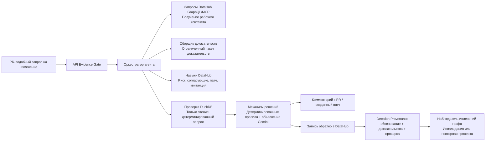

# Организационное мышление DataHub

### Первый рабочий процесс: Evidence Gate

## Одним предложением

Evidence Gate превращает разовые решения по управлению данными в связанную с графом организационную память, которая остаётся достоверной: при изменении исходных метаданных она автоматически признаёт себя устаревшей.

```
PR / запрос на изменение → Evidence Gate → Decision Provenance в DataHub → будущий агент спрашивает «почему?» → граф меняется → сведения устаревают → похожее изменение использует их как прецедент
```

> Это не очередной журнал аудита и не новая система согласований. DataHub уже знает, что с чем связано. Пока он не умеет хранить *почему* было принято решение и замечать, когда это обоснование перестаёт быть верным. «Организационное мышление» — общий подход, а Evidence Gate — его первый конкретный рабочий процесс для важного случая: рискованного изменения схемы или метрики.

**Трек:** генерация и разработка кода с учётом метаданных (также подходит для «агентов, которые делают реальную работу»)

## Ключевые инженерные свойства

- ✅ Детерминированный механизм принятия решений: решение принимают правила и проверка, а не LLM.
- ✅ Проверочный запрос только на чтение и из разрешённого списка.
- ✅ На всём пути используется настоящий граф DataHub, без имитации происхождения в демо.
- ✅ Decision Provenance записывается обратно в реальный актив.
- ✅ Автоматическая инвалидация при изменении состояния графа.
- ✅ Поиск прецедентов среди похожих изменений.
- ✅ 39 автоматизированных тестов, в том числе с аккуратной обработкой сбоев.

## Какую проблему решает проект

Через шесть месяцев после миграции любой скажет, кто слил PR. Почти никто не скажет, какие доказательства её оправдывали и остаётся ли это обоснование верным сегодня. Такое регулярно происходит: схему переименовали, три дашборда незаметно устарели, а единственный след «почему мы решили, что это безопасно» — сообщение в Slack, которое уже не найти.

В DataHub уже есть граф: происхождение, владение, термины глоссария, состояние качества. Evidence Gate использует этот граф, чтобы действительно проверить предложенное изменение до выпуска, а затем записывает обоснование обратно в сам актив. Поэтому *почему* хранится там же, где и *что связано*, а не в отдельной системе, куда никто не заглядывает.

## Что делает Evidence Gate

Перед выпуском рискованного изменения схемы, переопределения метрики или отмены проверки качества Evidence Gate:

- **Читает** реальный контекстный граф DataHub — происхождение, владение, термины глоссария и состояние качества — прямыми запросами GraphQL/MCP-подобного вида к GMS DataHub.
- **Принимает решение** детерминированными правилами. Неконтролируемый вызов LLM не может ни разрешить, ни заблокировать изменение.
- **Записывает решение обратно** в затронутый актив DataHub, чтобы его можно было запросить так же, как остальные данные об активе.
- **Знает, когда перестать доверять прежнему решению**: если позже меняется условие, на которое оно опиралось (связь с глоссарием удалена, появилась неуспешная проверка), старое обоснование помечается устаревшим.

## Сценарий демо

Инженер предлагает переименовать `order_total` в `recognized_revenue` в наборе Snowflake `order_entry_db.analytics.order_details`. Это реальный набор данных из демонстрационных данных `showcase-ecommerce` DataHub; он связан с терминами глоссария «Сумма заказа» и «Доход по классу клиента» и используется активами PowerBI, Looker, Tableau и dbt.

Пример выбран намеренно, а не синтетически: `order_total` (валовая стоимость транзакции) и «признанный доход» (бухгалтерское понятие, которое обычно не включает налог и невыполненные заказы) на деле не равны. Этап проверки это доказывает.

1. Evidence Gate получает реальный контекст актива: зависимые дашборды, владельцев, происхождение, определения глоссария и текущее состояние качества.
2. Он запускает запрос проверки только на чтение, сравнивая прежний и предложенный агрегаты с фикстурой заказов.
3. Он **блокирует** изменение: проверка показывает сдвиг агрегата на 13,16%, намного больше допуска; называет требуемых согласующих и создаёт патч совместимости и миграционный тест.
4. Он записывает в актив DataHub Decision Provenance: обоснование, выполненные проверки, результат валидации, балл риска и срок повторной проверки.
5. Второй, полностью независимый процесс спрашивает «почему это было заблокировано?» и отвечает, читая реально сохранённые данные из DataHub, а не восстанавливая их по догадкам.
6. Затем имитируется изменение одного из исходных условий (удаление связи с глоссарием), и сохранённое решение получает в DataHub статус `stale`.
7. Поступает похожий второй запрос; он находит решение как прецедент и прямо показывает, что остаётся применимым, а что отличается.

## Архитектура



**О выборе Agent Context Kit и Analytics Agent.** Оба инструмента были проверены непосредственно в этом проекте и намеренно не используются. DataHub Agent Context Kit (`datahub-agent-context`) предоставляет `get_lineage`, `get_entities` и `get_dataset_assertions`, но в локальном DataHub Quickstart `get_lineage` читает поисковый индекс и вернул ноль зависимых потребителей для актива, у которого прямой обход графа GraphQL находит реальные BI-дашборды. Индекс просто не успел обновиться; та же проблема была у `get_dataset_assertions`. Поэтому здесь используются прямые запросы GraphQL, которые читают хранилище графа, а не поисковый индекс.

Отдельно проверялось приложение Analytics Agent для валидации. Оно построено на LangGraph и генерирует SQL через LLM; это подходит для открытых запросов «задать вопрос», но не для проекта, в котором проверка обязана быть детерминированной и разрешённой заранее. Поэтому используется простой запрос DuckDB.

## Посмотрите, как это работает

Главная особенность проекта — распознать, что собственное прежнее решение больше не верно, — плохо передаётся текстом. Ниже это происходит в реальном времени в запущенном DataHub:


Это не постановка: вывод терминала — настоящий неизменённый запуск `scripts/run_demo_timeline.py` для реального актива из фикстур этого репозитория.

### Решение прямо в реальном активе DataHub

Это не отдельный журнал аудита: перед вами реальные пользовательские свойства самого `ORDER_DETAILS`, читаемые как и любое другое поле актива.


### Связь с источником и отображение там, где команда уже работает


## Что здесь действительно ново

Проект не претендует на изобретение происхождения, журналов аудита или процессов согласования — DataHub и другие инструменты уже хорошо это умеют. Новизна в другом: привязать конкретное решение к точным доказательствам, позволить использовать это рассуждение как прецедент для похожего будущего изменения и обнаружить, когда состояние графа, лежавшее в основе старого решения, разошлось с реальностью. Весь путь демо работает с настоящим DataHub: статический JSON не подменяет граф, происхождение не имитируется.

## Структура репозитория

```
.
├── README.md
├── LICENSE                  # Apache 2.0
├── SKILL.md                 # Руководство по сборке и проверке для кодового агента
├── .devcontainer/
│   └── devcontainer.json    # Конфигурация Codespaces: Docker-in-Docker, Python
├── src/
│   ├── api/                 # Оркестратор FastAPI (точка входа Evidence Gate)
│   ├── discovery/           # Клиентские вызовы DataHub GraphQL/MCP-подобного вида
│   ├── evidence/            # Построение пакета доказательств
│   ├── validation/          # Запрос сравнения дохода только на чтение (DuckDB/фикстура)
│   ├── decision/            # Детерминированные правила риска и объяснение LLM
│   ├── remediation/         # Создание совместимого с dbt патча и теста
│   ├── writeback/           # Запись Decision Provenance в DataHub
│   ├── invalidation/        # Наблюдатель изменений графа
│   └── precedent/           # Поиск и сравнение прецедентов
├── skills/                  # Независимые обёртки CLI вокруг той же логики
├── oss-contribution-draft/  # Обобщённый навык, подготовленный для datahub-skills
├── examples/                # Примеры диффа схемы, доказательств, решения, патча и обоснования
├── tests/                   # Модульные тесты: риск, проверка, запись, инвалидация, прецеденты
├── fixtures/                # Пакет showcase-ecommerce и фикстура дохода
└── docs/                    # Настройка, устранение неполадок, тесты, демо и OSS-вклад
```

## Запуск

Проект создан в **GitHub Codespace**, а не на локальной машине: стек Docker для DataHub требует значительного объёма памяти. Бесплатный тариф Codespaces (2 ядра, 8 ГБ RAM, 32 ГБ хранилища) покрывает это без локальной установки Docker; конфигурация devcontainer автоматически включает Docker-in-Docker.

```bash
# 0. Откройте репозиторий в Codespace: Code → Codespaces → Create codespace on main.
#    Конфигурация .devcontainer/devcontainer.json автоматически поднимет Docker-in-Docker.

# 1. Запустите DataHub и загрузите образцы данных в терминале Codespace
datahub docker quickstart
python scripts/load_showcase_ecommerce.py

# 2. Установите зависимости
python -m venv .venv && source .venv/bin/activate
pip install -r requirements.txt

# 3. Настройте окружение
cp .env.example .env   # задайте DATAHUB_GMS_URL, DATAHUB_MCP_URL, GEMINI_API_KEY

# 4. Запустите API
uvicorn src.api.main:app --reload

# 5. Отправьте включённый запрос на изменение из фикстуры
python scripts/submit_change.py --fixture fixtures/net_revenue_rename.json

# 6. Просмотрите записанное в DataHub обоснование решения
# Codespaces автоматически перенаправляет порт 9002. Откройте URL на вкладке «Порты»
# и найдите затронутый актив.
```

Полное описание переменных окружения, остановки стенда, перенаправления портов и устранения неполадок находится в `docs/setup.md` и `docs/troubleshooting.md`.

На бесплатном тарифе Codespaces завершайте работу остановкой codespace, а не закрытием вкладки: остановленный codespace оплачивает только небольшой объём хранения, но не вычислительное время.

## Чего проект намеренно не делает

- Он не сливает PR и не развёртывает изменения автоматически. Результат `approved` по-прежнему требует фактического согласования перечисленными людьми.
- Модель никогда сама не принимает решение разрешить или заблокировать изменение: это делают правила. Модель лишь объясняет доказательства и составляет план исправления.
- Проверка работает только с фикстурой или образцом данных, в режиме чтения и только с одним заранее зарегистрированным запросом сравнения; произвольный SQL не генерируется.
- Сквозным образом покрывается один тип изменения (переименование поля дохода), а не множество недоделанных сценариев.

## Модель безопасности

- **Область чтения:** запросы обнаружения (происхождение, глоссарий, владение, качество) только читают граф DataHub и не меняют структурные метаданные актива.
- **Область проверки:** единственный запрос совместимости внесён в разрешённый список и жёстко задан; LLM не генерирует произвольный SQL, а проверка всегда работает только с локальными данными фикстуры, никогда с production.
- **Область записи:** система пишет только Decision Provenance — пользовательские свойства, ссылку institutional memory и инцидент при блокировке; она не меняет схему, не сливает PR и не развёртывает код.
- **Обязательное участие человека:** `approved` перечисляет необходимых согласующих, но не заменяет их согласование. Заблокированное изменение остаётся заблокированным, пока человек не исправит ситуацию.
- **Изоляция LLM:** Gemini получает только уже вычисленные факты — балл риска, сработавшие правила и дельту проверки. Она превращает их в читаемый текст или черновик миграционного патча и не может повлиять на решение. Явная проверка галлюцинаций отклоняет ответы, ссылающиеся на несработавшие сигналы, и возвращает шаблонный текст.

## Примеры

`examples/` содержит полное прохождение без запуска: входной дифф схемы, пакет доказательств, вывод заблокированного решения, сгенерированный патч dbt и реальную полезную нагрузку обоснования, записанную в DataHub.

## Вклад в открытый исходный код

Логика записи, прецедентов и устаревания вынесена в обобщённый навык для `datahub-project/datahub-skills`; из личной учётной записи автора открыт настоящий pull request:

https://github.com/datahub-project/datahub-skills/pull/71

Подробности и обоснование приведены в `docs/oss-contribution.md`.

## Лицензия

Apache 2.0 — см. [LICENSE](./LICENSE).
